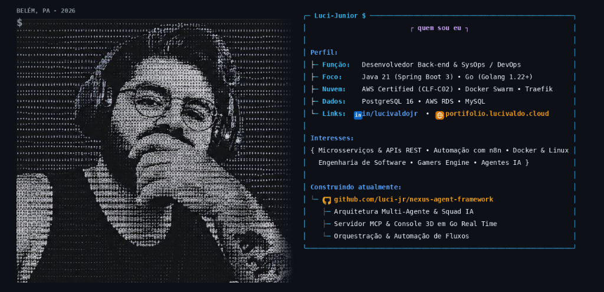
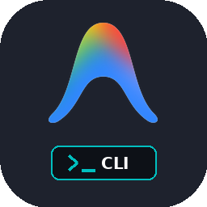
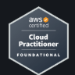
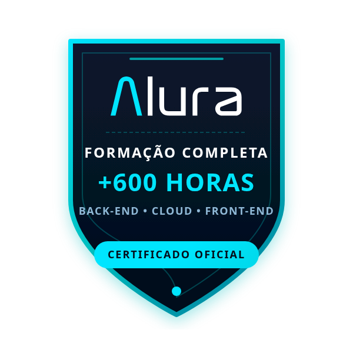
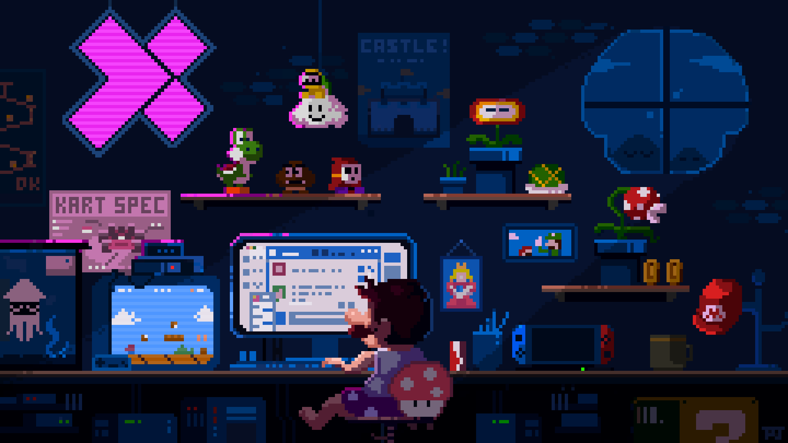

  

  

 

  

 

  

    
    
    
    
    
    
    
  

 

---

## 🚀 Sobre mim

Desenvolvedor de Software focado em **Desenvolvimento Back-end (Java 21, Spring Boot 3 e Go 1.22+)**, **Sistemas Distribuídos & Concorrência**, infraestrutura **Cloud & DevOps (AWS, Docker Swarm, Traefik)** e **Engenharia de Inteligência Artificial & Agentes Autônomos**. Experiência prática na construção e sustentação de microsserviços em produção, automação corporativa com **n8n**, governança de bancos de dados (**PostgreSQL, Redis**) e servidores **MCP (Model Context Protocol)** em Go para orquestração de squads multi-agente.

Possuo uma bagagem prévia de **15+ anos na liderança de equipes em ambientes de alta pressão contínua** (atuando como Chef de Cozinha e Gestor de Operações), o que me consolidou extrema disciplina operacional, inteligência emocional, foco em SLA/entregas críticas e rápida tomada de decisão em incidentes.

Certificado oficialmente como **AWS Certified Cloud Practitioner (CLF-C02)** e graduado pelo programa intensivo **AWS re/Start Graduate (300h)**, aplico padrões de **Clean Architecture**, resiliência transacional e observabilidade no ciclo completo de engenharia de software.

 

---

## 💼 Experiência & Atuação de Mercado

<table align="center" width="100%">
  <tr>
    <td width="50%" valign="top">
      <h3>🏢 Dobem Tech</h3>
      
<b>Desenvolvedor Back-end / DevOps</b> (01/2025 – 03/2026)

      
• Desenvolvimento e sustentação de microsserviços RESTful em <b>Java 21</b> e <b>Spring Boot 3</b> com Spring Data JPA e controle de acesso RBAC com Spring Security. 
      • Automação de fluxos com <b>n8n</b>, integrando WhatsApp Business API, Chatwoot e ERP Odoo, reduzindo o tempo do primeiro atendimento em mais de 60%. 
      • Sustentação de clusters de containers em <b>Docker Swarm</b> com proxy reverso <b>Traefik v2</b> e infraestrutura <b>AWS (EC2, S3, RDS)</b> com zero downtime. 
      • Implementação de camada de cache em memória com <b>Redis</b> integrado ao <b>PostgreSQL</b> para mitigação de latência sob picos de tráfego.

    </td>
    <td width="50%" valign="top">
      <h3>🛡️ Cyberethic Solution</h3>
      
<b>Desenvolvedor Júnior / DevOps</b> (08/2023 – 11/2024)

      
• Provisionamento e monitoramento de infraestrutura em nuvem na <b>AWS (EC2 e S3)</b>, com isolamento via VPCs e políticas de privilégio mínimo no IAM. 
      • Padronização e conteinerização de aplicações com <b>Docker</b> e automação de scripts de rotina operacional em <b>Bash / Linux CLI</b>. 
      • Modelagem e tuning de banco de dados relacional <b>PostgreSQL</b>, criando índices estratégicos para acelerar consultas analíticas. 
      • Resolução de incidentes em produção, análise de logs e suporte técnico N2/N3 focado na causa-raiz.

    </td>
  </tr>
</table>

 

---

## 🛠️ Habilidades Técnicas

<h2 align="center">🤖 Inteligência Artificial & Agentes Autônomos</h2>
<table align="center">
<tr>
<td align="center" width="130">
 <b>Model Context Protocol (MCP)</b>
</td>
<td align="center" width="130">
 <b>Antigravity CLI</b>
</td>
<td align="center" width="130">
 <b>Multi-Agent Squads</b>
</td>
<td align="center" width="130">
 <b>Context Engineering</b>
</td>
</tr>
</table>

---

<h2 align="center">☕ Back-End & Bancos de Dados</h2>
<table align="center">
<tr>
<td align="center" width="125">
 <b>Java 21 LTS</b>
</td>
<td align="center" width="125">
 <b>Spring Boot 3</b>
</td>
<td align="center" width="125">
 <b>Go 1.22+</b>
</td>
<td align="center" width="125">
 <b>PostgreSQL 16</b>
</td>
<td align="center" width="125">
 <b>AWS RDS</b>
</td>
<td align="center" width="125">
 <b>Redis</b>
</td>
</tr>
</table>

---

<h2 align="center">☁️ Cloud, SysOps & DevOps</h2>
<table align="center">
<tr>
<td align="center" width="120">
 <b>AWS Cloud</b>
</td>
<td align="center" width="120">
 <b>GCP</b>
</td>
<td align="center" width="120">
 <b>Docker Swarm</b>
</td>
<td align="center" width="120">
 <b>Traefik v2</b>
</td>
<td align="center" width="120">
 <b>Linux CLI</b>
</td>
<td align="center" width="120">
 <b>CI / CD</b>
</td>
</tr>
</table>

---

<h2 align="center">⚡ Automação, Integrações & Produtividade</h2>
<table align="center">
<tr>
<td align="center" width="120">
 <b>n8n</b>
</td>
<td align="center" width="120">
 <b>Meta API</b>
</td>
<td align="center" width="120">
 <b>Evolution Go</b>
</td>
<td align="center" width="120">
 <b>Git</b>
</td>
<td align="center" width="120">
 <b>GitHub</b>
</td>
<td align="center" width="120">
 <b>Trello (Kanban)</b>
</td>
</tr>
</table>

---

<h2 align="center">💻 Front-End Reativo (Apoio & Fullstack)</h2>
<table align="center">
<tr>
<td align="center" width="120">
 <b>Angular 21/22+</b>
</td>
<td align="center" width="120">
 <b>TypeScript</b>
</td>
<td align="center" width="120">
 <b>JavaScript ES6+</b>
</td>
<td align="center" width="120">
 <b>HTML5</b>
</td>
<td align="center" width="120">
 <b>CSS3</b>
</td>
</tr>
</table>

 

---

## 🏆 Formação, Certificações & Badges

  <table cellpadding="8">
    <tr>
      <td align="center" width="145">
        <a href="https://www.credly.com/badges/972bc121-806a-4cbc-a9f2-c2d6d9c23061/public_url" target="_blank">
           
          <b>AWS re/Start Graduate</b> (300h)
        </a>
      </td>
      <td align="center" width="145">
        <a href="https://www.credly.com/badges/18c251c3-0f10-4206-a71c-a00638b75978/public_url" target="_blank">
           
          <b>AWS Cloud Practitioner</b> (CLF-C02)
        </a>
      </td>
      <td align="center" width="145">
        <a href="https://cursos.alura.com.br/user/lucivaldojr25/fullCertificate/888548fd987b6f473d840136e462e556" target="_blank">
           
          <b>Alura Formação Contínua</b> (+600h)
        </a>
      </td>
    </tr>
  </table>

 

<table align="center" width="100%">
  <tr>
    <td width="50%" valign="top">
      <h3>☁️ AWS re/Start Graduate</h3>
      
Formação Intensiva em Nuvem (300h) — AWS & Escola da Nuvem 
      🏅 <i><a href="https://www.credly.com/badges/972bc121-806a-4cbc-a9f2-c2d6d9c23061/public_url" target="_blank">Badge Oficial Credly</a></i>

    </td>
    <td width="50%" valign="top">
      <h3>☁️ AWS Certified Cloud Practitioner</h3>
      
Certificação Oficial da Indústria (CLF-C02) — Amazon Web Services 
      🏅 <i>Validation: <code>c7992367362a4687a1b60804c98bac46</code> • <a href="https://www.credly.com/badges/18c251c3-0f10-4206-a71c-a00638b75978/public_url" target="_blank">Badge Oficial Credly</a></i>

    </td>
  </tr>
  <tr><td colspan="2"> </td></tr>
  <tr>
    <td width="50%" valign="top">
      <h3>☕ Especializações Back-End & Cloud (+600h)</h3>
      
• Trilha Completa de Engenharia em Go (APIs RESTful, Gin, Concorrência, Testes) 
      • Formação Java & Spring Boot 3 (POO, JPA, Coleções, Migrations, Segurança) 
      • Especialização em Nuvem AWS (EC2, S3, VPC, RDS, DynamoDB, Gestão de Custos) 
      🏅 <i><a href="https://cursos.alura.com.br/user/lucivaldojr25/fullCertificate/888548fd987b6f473d840136e462e556" target="_blank">Certificado Unificado Alura</a></i>

    </td>
    <td width="50%" valign="top">
      <h3>💻 Especializações Front-End & SysOps (+600h)</h3>
      
• Formação Angular & TypeScript (Signals, Standalone Components, RxJS) 
      • Desenvolvimento Web Front-End (HTML5, CSS3 responsivo, ES6+) 
      • Linux Onboarding (CLI, Gestão de Processos e Permissões) & Git/GitHub 
      🏅 <i><a href="https://cursos.alura.com.br/user/lucivaldojr25/fullCertificate/888548fd987b6f473d840136e462e556" target="_blank">Certificado Unificado Alura</a></i>

    </td>
  </tr>
</table>

 

---

## 🗂️ Projetos em Destaque

<table align="center" width="100%">
  <tr>
    <td width="50%" valign="top">
      <h3> Nexus Ecosystem (Open Source Edition) — Squad de IA & Servidor MCP</h3>
      
A versão aberta da plataforma autônoma multi-agente projetada para orquestração de desenvolvimento, automações operacionais e engenharia de contexto. Integra um servidor <b>Model Context Protocol (MCP)</b> construído em <b>Go (Golang 1.22+)</b> com comunicação bidirecional via JSON-RPC, persistência local em cofre de conhecimento tipado (Nexus Vault), execução de ferramentas sandboxed e governança de tarefas concorrentes.

      

        
        
        
        
        
      

      <a href="https://github.com/luci-jr/nexus-ecosystem-open">📁 Ver Repositório</a>
    </td>
    <td width="50%" valign="top">
      <h3>🎰 Engine de Apostas (<a href="https://junglegaming.io/pt" target="_blank">Jungle Gaming</a>) — Jungle Slots 1987</h3>
      
Microsserviço financeiro distribuído de alta concorrência para processamento e liquidação de apostas (<i>iGaming / Sportsbook</i>) desenvolvido em <b>Go 1.22+</b> e <b>Uber Fx</b>. Modelagem monetária estrita em centavos (zero float), controle transacional com locks pessimistas (<code>SELECT ... FOR UPDATE</code>), Ledger imutável com triggers SQL, <b>AWS SQS FIFO</b> (deduplicação e DLQ), <b>Keycloak 24 OIDC (JWT RS256)</b> e simulador em <b>Go WebAssembly (WASM)</b>.

      

        
        
        
        
        
        
      

      <a href="https://github.com/luci-jr/desafio-jungle-game">📁 Ver Repositório</a>
    </td>
  </tr>
  <tr><td colspan="2"> </td></tr>
  <tr>
    <td width="50%" valign="top">
      <h3>🏹 Égua Mano! Gamer — Jogo de Plataforma 2D em Go</h3>
      
Jogo de ação e plataforma 2D construído em <b>Go</b> com a <b>Ebitengine v2</b>, ambientado na cultura de Belém do Pará (Ver-o-Peso, Estação das Docas). Apresenta mecânica de pulo com altura variável e pulo duplo, colisão AABB, sintetizador procedural de áudio chiptune 8-bit em código Go puro (ondas NES) e compilação cruzada para WebAssembly (jogável no navegador), desktop e Android.

      

        
        
        
        
      

      <a href="https://github.com/luci-jr/egua-mano_gamer">📁 Ver Repositório</a> &nbsp;|&nbsp; <a href="https://luci-jr.github.io/egua-mano_gamer/">🕹️ Jogar Online</a>
    </td>
    <td width="50%" valign="top">
      <h3>🌐 Comunidade Tech — Plataforma de Curadoria Educacional</h3>
      
Plataforma web concebida para apoiar iniciantes na área de Tecnologia da Informação com trilhas estruturadas por sistemas operacionais (Linux, WSL2, MacOS), linguagens e murais comunitários. SPA reativa desenvolvida em <b>Angular 21</b> com Signals, Control Flow moderno e integração de persistência em tempo real com <b>Firebase (Firestore & Hosting)</b>.

      

        
        
        
      

      <a href="https://github.com/luci-jr/comunidade-tech">📁 Ver Repositório</a> &nbsp;|&nbsp; <a href="https://comunidade.tech.lucivaldo.cloud/inicio">🌍 Acessar Online</a>
    </td>
  </tr>
</table>

 

---

## 📊 Estatísticas do GitHub

<table align="center" border="0" cellspacing="0" cellpadding="0">
  <tr>
    <td valign="top" align="center">
      
    </td>
    <td width="10"></td>
    <td valign="top" align="center">
      
    </td>
  </tr>
</table>

 

  

 

  <h2>🚩 Minha Jornada Dev</h2>
  

 

---

<h2 align="center">📫 Entre em Contato</h2>
<table align="center">
<tr>
<td align="center" width="125">
<a href="https://www.linkedin.com/in/lucivaldojr/" target="_blank">
 <b>LinkedIn</b>
</a>
</td>
<td align="center" width="125">
<a href="https://wa.me/5591982687350" target="_blank">
 <b>WhatsApp</b>
</a>
</td>
<td align="center" width="125">
<a href="https://portifolio.lucivaldo.cloud" target="_blank">
 <b>Portfólio Web</b>
</a>
</td>
<td align="center" width="125">
<a href="https://discord.com/users/pequeno1987" target="_blank">
 <b>Discord</b>
</a>
</td>
</tr>
</table>

 

  

 

  

